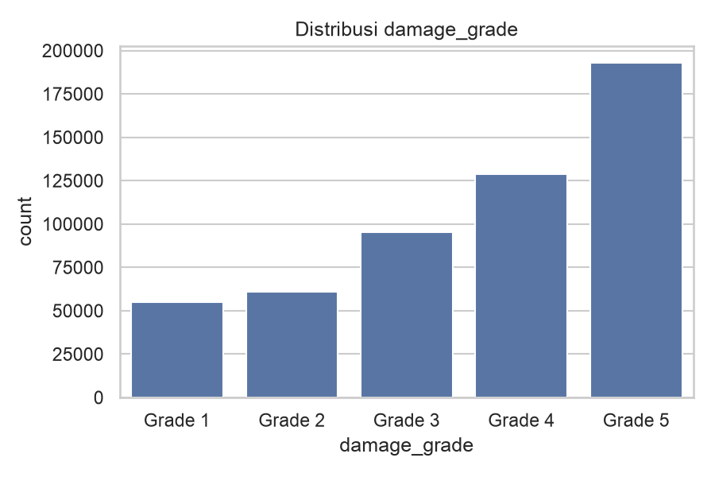
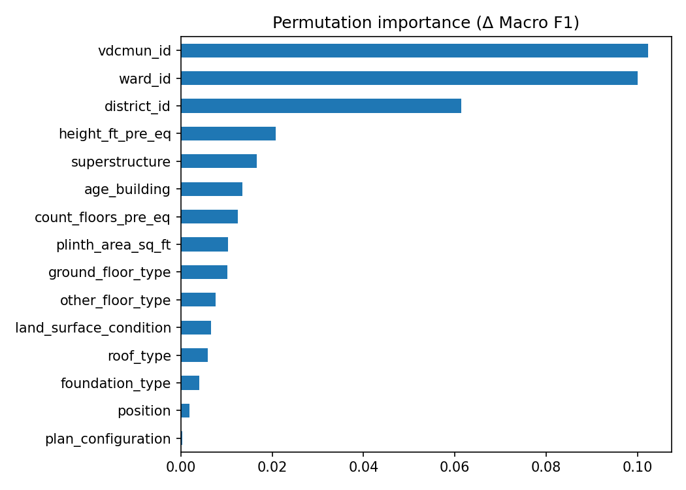

# Structural Damage Classification

Klasifikasi tingkat kerusakan bangunan (`damage_grade` 1-5) setelah gempa Gorkha, Nepal 2015, untuk kompetisi Kaggle **structural-damage-classification**. Metrik evaluasi: **Macro F1**. Sesuai aturan tugas, tidak ada Neural Network yang dipakai.

Tugas tambahan: membandingkan strategi multi-kelas **One-vs-All (OvA)** dan **One-vs-One (OvO)**.

## Hasil singkat

| Evaluasi | Macro F1 |
|---|---|
| Baseline Logistic Regression (3-fold CV, data penuh) | 0,4524 |
| HistGradientBoosting + OvO, CV tuning (subsampel 100 ribu) | 0,4924 |
| HistGradientBoosting + OvO, hold-out 20% (data penuh) | 0,5134 |
| Public leaderboard Kaggle | 0,51329 |

## Struktur repository

```
StructuralDamageClassification/
├── README.md
├── requirements.txt
├── .gitignore
├── data/                      # train.csv dan test.csv (diunduh manual, tidak di-commit)
├── notebooks/
│   ├── 01_eda.ipynb           # eksplorasi data
│   ├── 02_modeling.ipynb      # OvA vs OvO, perbandingan model, tuning, feature importance
│   └── 03_submission.ipynb    # prediksi test, validasi format, distribusi prediksi
├── scripts/
│   ├── feature_engineering.py # FeatureEngineer (transformer scikit-learn)
│   ├── preprocess.py          # ColumnTransformer + build_pipeline + encoding target
│   ├── models.py              # daftar model, strategi OvR/OvO, ruang tuning
│   ├── train.py               # CLI training / tuning
│   └── predict.py             # CLI prediksi + pembuatan submission
├── models/
│   └── best_params.json       # hyperparameter hasil tuning (model.joblib dibuat lokal)
└── reports/
    ├── figures/               # gambar EDA, confusion matrix, feature importance
    └── tables/                # tabel perbandingan strategi/model dan feature importance
```

## Cara menggunakan repository

### 1. Siapkan environment
```bash
git clone <url-repo>
cd StructuralDamageClassification
python -m venv .venv
source .venv/bin/activate          # Windows: .venv\Scripts\activate
pip install -r requirements.txt
```

### 2. Unduh data
Unduh `train.csv` dan `test.csv` dari halaman Data kompetisi Kaggle, lalu letakkan di folder `data/`. Dengan Kaggle CLI:
```bash
kaggle competitions download -c structural-damage-classification -p data
unzip data/structural-damage-classification.zip -d data
```

### 3. Jalankan notebook (dari folder `notebooks/` atau root repo)
1. `01_eda.ipynb` untuk eksplorasi data.
2. `02_modeling.ipynb` untuk perbandingan strategi dan model, tuning, serta feature importance. Menghasilkan `models/best_params.json` dan tabel di `reports/tables/`.
3. `03_submission.ipynb` untuk membuat dan memvalidasi `submission.csv`. Notebook ini membutuhkan `models/model.joblib` dari langkah 4.

### 4. Latih model akhir dan buat submission lewat command line
Semua perintah dijalankan dari **root repo**.
```bash
# Latih model akhir pada data penuh dengan hyperparameter hasil tuning (beberapa menit)
python -m scripts.train --model hgb --strategy ovo --params models/best_params.json --skip-cv

# Prediksi data test
python -m scripts.predict --model models/model.joblib --out submission.csv
```
Opsi lain pada `scripts.train`: `--model {logreg,rf,et,hgb}`, `--strategy {native,ovr,ovo}`, `--tune --n-iter 20` (tuning ulang), dan tanpa `--skip-cv` untuk menghitung CV Macro F1 sebelum fit akhir.

`submission.csv` berisi kolom `building_id` dan `damage_grade` (angka 1-5), siap diunggah ke Kaggle.

## Workflow analisis

1. **EDA** (`01_eda.ipynb`): memeriksa kualitas data, distribusi target, fitur numerik, kategorikal, lokasi, dan kesamaan distribusi train vs test.
2. **Preprocessing dan feature engineering** (`scripts/`): semua langkah berada dalam satu `Pipeline`, sehingga statistik hanya dipelajari dari data latih di tiap fold (tanpa data leakage).
3. **Baseline**: Logistic Regression.
4. **Eksperimen** (`02_modeling.ipynb`): OvA vs OvO vs native, perbandingan empat model non-NN, tuning, validasi hold-out, dan feature importance.
5. **Model akhir dan submission**: HistGradientBoosting + OvO dengan parameter hasil tuning, dilatih pada data penuh.

### Pipeline

```
FeatureEngineer  ->  ColumnTransformer  ->  Model
```

- **`FeatureEngineer`** (`feature_engineering.py`): mengganti `age_building = 999` dengan NaN dan menambah flag `age_unknown`; menambah `height_per_floor` dan `volume_proxy`; mengubah ID wilayah menjadi kategori; membuang `building_id`.
- **`ColumnTransformer`** (`preprocess.py`) menyesuaikan jenis model:
  - `linear`: imputasi median + StandardScaler untuk numerik, One-Hot Encoding (kategori langka digabung) untuk kategorikal; `ward_id` tidak dipakai karena terlalu banyak kategori.
  - `tree`: imputasi median untuk numerik dan Ordinal Encoding untuk kategorikal termasuk `ward_id`.
- **Model** (`models.py`): Logistic Regression, Random Forest, Extra Trees, dan HistGradientBoosting, semuanya dengan `class_weight="balanced"` untuk menangani ketidakseimbangan kelas.

## Laporan interpretasi

### 1. Temuan EDA
- **Kelas tidak seimbang**: Grade 5 sebesar 36,2% dan Grade 1 hanya 10,3%. Karena metriknya Macro F1, dipakai Stratified K-Fold, `class_weight="balanced"`, dan evaluasi F1 per kelas.
- **`age_building = 999`** muncul pada 0,41% baris di train maupun test dengan proporsi yang sama. Nilai ini ditafsirkan sebagai kode "umur tidak diketahui", bukan umur sebenarnya.
- **Lokasi paling berpengaruh**: Grade 5 mencapai 81% di distrik 23, tetapi hanya 9% di distrik 31.
- **Material**: fondasi RC dan atap RCC jauh lebih tahan (59% dan 55% Grade 1, hanya 2% Grade 5) dibanding fondasi mud mortar-stone/brick (42% Grade 5).
- **Distribusi train dan test sangat mirip** pada `district_id`, `foundation_type`, `roof_type`, dan `superstructure` (selisih proporsi sekitar 0,001), dan seluruh ward di test ada di train. Fitur lain belum dibandingkan.



### 2. One-vs-All vs One-vs-One

Macro F1 (3-fold CV, subsampel stratified 100 ribu baris):

| Model | Native | OvA | OvO |
|---|---|---|---|
| Logistic Regression | 0,4485 | 0,4434 | 0,4484 |
| HistGradientBoosting | 0,4798 | 0,4693 | **0,4832** |

- **OvA paling buruk** pada kedua model (turun 0,005 pada Logistic Regression dan 0,011 pada HistGradientBoosting). Penyebab yang mungkin: grade berurutan, sehingga kelas bertetangga (misalnya 2 dan 3) mirip dan sulit dipisahkan dari "semua kelas lainnya".
- **OvO** sedikit di atas native pada HistGradientBoosting (+0,003), selisih yang hanya sekitar 1-2 kali simpangan baku, sehingga OvO dan native praktis setara. OvO lebih cocok daripada OvA karena tiap model biner hanya membandingkan dua kelas dan tidak terganggu oleh kelas "sisanya" yang besar.
- **Biaya**: OvO pada HistGradientBoosting sekitar 2 kali lebih lama dari native (10,8 vs 5,7 detik).

### 3. Perbandingan model (strategi native)

| Model | Macro F1 | Waktu (detik) |
|---|---|---|
| HistGradientBoosting | **0,4798** | 5,7 |
| Random Forest | 0,4766 | 11,3 |
| Extra Trees | 0,4656 | 9,6 |
| Logistic Regression | 0,4485 | 4,5 |

Model berbasis pohon unggul jelas dari model linear, yang menandakan adanya hubungan non-linear dan interaksi antar fitur (misalnya lokasi dan material). HistGradientBoosting terbaik sekaligus tercepat.

### 4. Tuning dan hasil akhir
`RandomizedSearchCV` (20 kandidat, 3-fold) menaikkan Macro F1 CV HistGradientBoosting + OvO dari 0,4832 menjadi 0,4924. Pada hold-out 20% data penuh, Macro F1 mencapai **0,5134**, dan skor public leaderboard **0,51329** hampir sama. Kedekatan ini menunjukkan validasi lokal dapat dipercaya dan model tidak overfit.

| Kelas | Presisi | Recall | F1 |
|---|---|---|---|
| Grade 1 | 0,552 | 0,764 | 0,641 |
| Grade 2 | 0,334 | 0,365 | 0,349 |
| Grade 3 | 0,391 | 0,398 | 0,395 |
| Grade 4 | 0,481 | 0,473 | 0,477 |
| Grade 5 | 0,761 | 0,656 | 0,705 |

- **Grade 5 paling mudah** diprediksi, sedangkan **Grade 2 dan 3 paling sulit** karena tingkat kerusakan berurutan dan kelas tengah mirip dengan kedua tetangganya.
- Grade 1 punya recall tinggi tetapi presisi lebih rendah. Ini efek `class_weight="balanced"`: model lebih berani menebak kelas minoritas demi Macro F1.

### 5. Feature importance



- **Lokasi dominan**: `vdcmun_id` (0,102), `ward_id` (0,100), dan `district_id` (0,061) jauh di atas fitur lain. Ini sejalan dengan EDA dan kemungkinan merepresentasikan intensitas guncangan, kondisi tanah, dan praktik membangun setempat.
- **Karakteristik bangunan** di tingkat berikutnya: tinggi bangunan, jenis struktur atas (`superstructure`), umur, jumlah lantai, luas dasar, dan tipe lantai dasar. Jumlah lantai tetap berkontribusi meski median-nya sama di semua kelas pada EDA, kemungkinan lewat sebaran nilai atau interaksi dengan fitur lain.
- `roof_type` dan `foundation_type` tampak kecil meski EDA menunjukkan pengaruh besar. Salah satu penyebab yang mungkin: fitur material saling berkorelasi sehingga permutation importance membagi pengaruhnya.

### 6. Keterbatasan dan pengembangan lanjutan
- Model sangat bergantung pada lokasi. Hal ini valid untuk data test di wilayah yang sama (semua ward di test ada di train), tetapi belum tentu menggeneralisasi ke wilayah baru.
- Tuning dilakukan pada subsampel 100 ribu baris dan hanya 20 kandidat. Tuning lebih panjang berpotensi memberi sedikit peningkatan.
- ID wilayah saat ini di-encode dengan Ordinal Encoding. Target encoding yang dihitung di dalam fold, atau penyesuaian ambang probabilitas per kelas untuk memaksimalkan Macro F1, adalah kandidat perbaikan berikutnya.
- Label bersifat ordinal (Grade 1 sampai 5), sedangkan model memperlakukannya sebagai kelas yang setara. Pendekatan yang memanfaatkan urutan kelas dapat dicoba.
